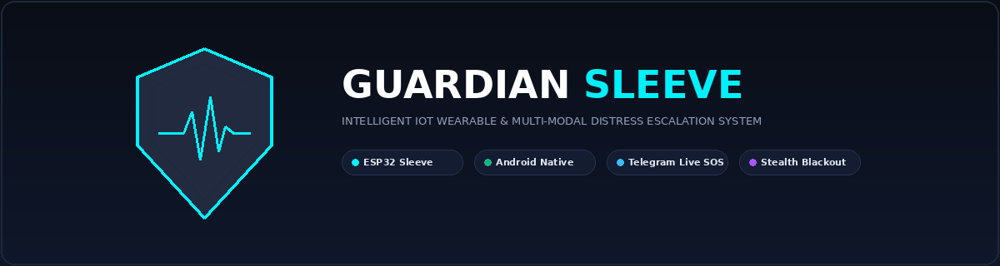
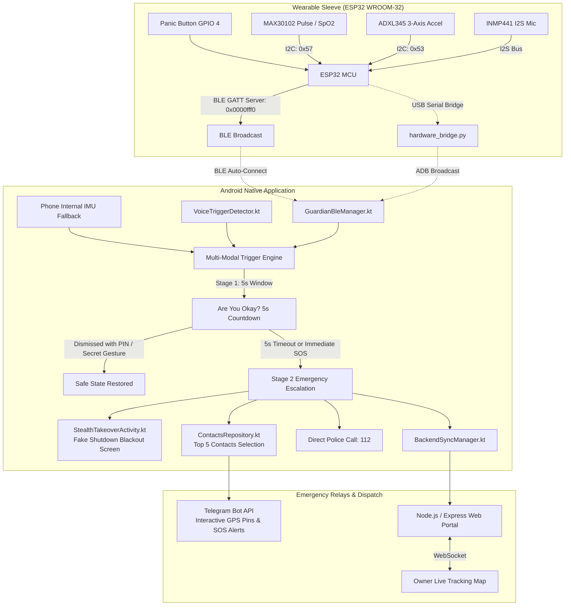

<p align="center">
  
</p>

<p align="center">
  <a href="LICENSE"></a>
  
  
  <a href="docs/TELEGRAM_API_SETUP.md"></a>
  
</p>

<p align="center">
  <b>Guardian Sleeve</b> is an IoT wearable safety system integrating an ESP32 sleeve with panic button, crash/fall, and vitals sensing with an Android app. It detects voice distress keywords, activates stealth blackout, and automatically broadcasts real-time GPS locations, Telegram SOS alerts, and emergency calls during accidents or abductions.
</p>

---

## 📑 Table of Contents

- [Overview & Threat Model](#-overview--threat-model)
- [System Architecture](#-system-architecture)
- [Hardware Schematic & Pinout](#-hardware-schematic--pinout)
- [Quick Start Guide](#-quick-start-guide)
  - [🐧 Linux / Ubuntu Setup](#-linux--ubuntu-setup)
  - [🪟 Windows (PowerShell) Setup](#-windows-powershell-setup)
- [Telegram Bot API Configuration](#-telegram-bot-api-configuration)
- [Repository Structure](#-repository-structure)
- [Multi-Modal Trigger Engine](#-multi-modal-trigger-engine)
- [Contributing & License](#-contributing--license)

---

## 🛡️ Overview & Threat Model

Traditional smartphone SOS apps fail when victims are physically restrained, suffer incapacitating accidents, or when assailants confiscate and attempt to power off the phone. **Guardian Sleeve** overcomes these vulnerabilities through a tightly synchronized IoT wearable and mobile architecture:

1. **Hostile Confiscation & Power-Off Resistance**: If an attacker attempts to force power down the phone, the app executes a **Stealth Screen Takeover ("Fake Shutdown")**. It displays an authentic Android shutdown animation and locks the display completely black (`#000000`, 0% brightness, touch gestures disabled). To the assailant, the device appears dead, while in the background `GuardianForegroundService` continuously tracks GPS and records ambient telemetry.
2. **Incapacitation, Hard Bangs & Falls**: The on-sleeve ADXL345 digital accelerometer detects free-fall ($<0.4\text{g}$) followed by severe collision ($>3.5\text{g}$) or high-energy crash impacts ($>4.8\text{g}$).
3. **Acute Panic & Tachycardic Surge**: The MAX30102 pulse oximeter monitors heart rate spikes ($>130\text{ BPM}$ or $\Delta > 35\text{ BPM}$) coupled with erratic movement.
4. **Vocal Distress & Zero-Power Acoustic Wake**: The INMP441 MEMS microphone wakes the mobile high-accuracy speech recognizer only when an acoustic shout threshold is exceeded, actively identifying distress keywords (`"HELP"`, `"BACHAO"`, `"SAVE ME"`, `"SOS"`, `"EMERGENCY"`).
5. **Zero-Latency Tactile Switch**: A physical panic button on GPIO 4 triggers immediate hardware interrupt escalation.

---

## 🧩 System Architecture



---

## ⚡ Hardware Schematic & Pinout

All sensors interface with the ESP32 WROOM-32 micro-controller operating at 3.3V logic:

| Component | Sensor Pin | ESP32 WROOM Pin | Protocol / Description |
| :--- | :--- | :--- | :--- |
| **Panic Button** | Terminal 1<br>Terminal 2 | **GPIO 4**<br>**GND** | Hardware Interrupt (`INPUT_PULLUP`, Active LOW) |
| **Status LED** | Anode (+)<br>Cathode (-) | **GPIO 2** (or Onboard)<br>**GND** | 220Ω resistor in series; signals BLE pairing & alerts |
| **MAX30102** | VCC / GND<br>SDA<br>SCL | **3.3V** / **GND**<br>**GPIO 21**<br>**GPIO 22** | I2C Data (Shared bus)<br>I2C Clock |
| **ADXL345** | VDD / GND<br>SDA / SCL<br>CS<br>SDO | **3.3V** / **GND**<br>**GPIO 21** / **GPIO 22**<br>**3.3V** (I2C Mode)<br>**GND** (I2C Address `0x53`) | Full resolution $\pm 16\text{g}$, 100 Hz output data rate |
| **INMP441** | VDD / GND<br>SCK<br>WS<br>SD<br>L/R | **3.3V** / **GND**<br>**GPIO 14**<br>**GPIO 15**<br>**GPIO 32**<br>**GND** (Left Channel) | I2S Serial Clock<br>I2S Word Select (LRCLK)<br>I2S Serial Data<br>Acoustic shout detection with DC bias removal |

---

## 🚀 Quick Start Guide

You can set up the entire stack (Cloud Backend, Hardware Serial Bridge, ESP32 Firmware, and Android Application) using the terminal commands below for your respective operating system.

### 🐧 Linux / Ubuntu Setup

Open your terminal and paste the following sequential commands:

```bash
# 1. Clone the repository
git clone git@github.com:Sain-Kai/guardiansleeve.git
cd guardiansleeve

# 2. Install Node.js backend dependencies & start Cloud Server
cd backend
npm install
node server.js &
cd ..

# 3. Set up Python virtual environment & dependencies for Hardware Bridge
python3 -m venv venv
source venv/bin/activate
pip install pyserial requests

# 4. Connect ESP32 via USB and run Hardware Serial Bridge
# (Ensure user is in dialout group: sudo usermod -a -G dialout $USER)
python3 scripts/hardware_bridge.py &

# 5. Build and install the Android Application (Emulator or Physical Device)
# (Ensure Android SDK & ADB are available in PATH)
./gradlew assembleDebug
adb install -r app/build/outputs/apk/debug/app-debug.apk

# 6. Launch the Guardian Sleeve Android Application
adb shell am start -n com.guardiansleeve.app/.ui.MainActivity
```

---

### 🪟 Windows (PowerShell) Setup

Open **PowerShell** as Administrator and run:

```powershell
# 1. Clone the repository
git clone git@github.com:Sain-Kai/guardiansleeve.git
cd guardiansleeve

# 2. Install Node.js backend dependencies & start Cloud Server
cd backend
npm install
Start-Process node -ArgumentList "server.js"
cd ..

# 3. Set up Python virtual environment & Hardware Serial Bridge
python -m venv venv
.\venv\Scripts\Activate.ps1
pip install pyserial requests

# 4. Start Hardware Bridge (Specify COM port where ESP32 is attached, e.g., COM3)
# Edit scripts/hardware_bridge.py SERIAL_PORT = "COM3" if required
Start-Process python -ArgumentList "scripts\hardware_bridge.py"

# 5. Build and install Android App (Requires Android SDK & ADB)
.\gradlew.bat assembleDebug
adb install -r app\build\outputs\apk\debug\app-debug.apk

# 6. Launch the App on Device / Emulator
adb shell am start -n com.guardiansleeve.app/.ui.MainActivity
```

---

## 🤖 Telegram Bot API Configuration

Guardian Sleeve dispatches interactive Google Maps GPS pins and biometric SOS messages to designated emergency contacts using the free **Telegram Bot API**.

### Setting Up Your Bot

1. Open Telegram and search for **`@BotFather`**.
2. Send `/newbot`, name your bot, and obtain your **HTTP API Token**:
   ```
   1234567890:ABCdefGhIJKlmNoPQRsTUVwxyZ
   ```
3. Have your emergency contacts send `/start` to your new bot.
4. Retrieve their numeric `chat_id` by visiting:
   ```
   https://api.telegram.org/bot<YOUR_BOT_TOKEN>/getUpdates
   ```
5. Configure your token in the app via the **Settings Dialog** (top-left gear icon) or configure [`app/src/main/java/com/guardiansleeve/app/data/AppSettings.kt`](app/src/main/java/com/guardiansleeve/app/data/AppSettings.kt):
   ```kotlin
   const val DEFAULT_TELEGRAM_BOT_TOKEN = "YOUR_TELEGRAM_BOT_TOKEN"
   ```
6. Add your emergency contact `chat_id`s in [`app/src/main/java/com/guardiansleeve/app/data/ContactsRepository.kt`](app/src/main/java/com/guardiansleeve/app/data/ContactsRepository.kt):
   ```kotlin
   EmergencyContact(
       id = "c1",
       name = "Primary Guardian",
       phone = "+10000000000",
       telegramChatId = "YOUR_PRIMARY_CHAT_ID",
       isFixed = true,
       relationship = "Parent / Guardian"
   )
   ```

To test emergency dispatch from the command line:
```bash
python3 scripts/test_telegram.py "YOUR_TELEGRAM_BOT_TOKEN" "YOUR_PRIMARY_CHAT_ID" 28.6139 77.2090
```

---

## 📁 Repository Structure

```
guardiansleeve/
├── assets/
│   ├── banner.svg                # Vector banner image
│   └── banner.png                # High-resolution raster banner
├── app/                          # Native Android Jetpack Compose Application
│   ├── src/main/java/com/guardiansleeve/app/
│   │   ├── ble/                  # BLE GATT client & packet parsers
│   │   ├── data/                 # Telegram API client, Haversine selector & settings
│   │   ├── model/                # Data models (Contacts, Telemetry, Alerts)
│   │   ├── service/              # GuardianForegroundService (Continuous background engine)
│   │   ├── ui/                   # Jetpack Compose UI (Dashboard, Stealth Takeover, Screens)
│   │   └── utils/                # VoiceTriggerDetector (Dual-layer ASR) & LocationHelper
│   └── AndroidManifest.xml       # Foreground service permissions & broadcast receivers
├── backend/                      # Node.js / Express Telemetry Relay & Web Portal
│   ├── public/                   # Real-time Leaflet.js Owner Tracking Map
│   ├── server.js                 # WebSocket & REST API server (Port 5000)
│   └── package.json
├── firmware/
│   └── GuardianSleeve_ESP32/     # Complete ESP32 Arduino / ESP-IDF C++ Firmware
│       └── GuardianSleeve_ESP32.ino
├── scripts/
│   ├── hardware_bridge.py        # USB Serial -> ADB Broadcast & Cloud Relay bridge
│   ├── test_telegram.py          # Standalone Telegram Bot API tester
│   └── update_hotspot_ip.sh      # Automated Wi-Fi / Hotspot IP synchronizer
├── docs/
│   ├── ARCHITECTURE.md           # Detailed multi-tier architectural spec
│   ├── HARDWARE_WIRING.md        # Circuit schematics & resistor values
│   └── TELEGRAM_API_SETUP.md     # Telegram BotFather step-by-step tutorial
├── LICENSE                       # MIT License
└── README.md
```

---

## 🎛️ Multi-Modal Trigger Engine

```
[ INMP441 Acoustic Shout ] ──► [ Wakes Mobile Mic (6s) ] ──► [ Keyword Match / Vocal Distress ] ──┐
[ Physical Panic Button  ] ──► [ Instant Interrupt (GPIO 4) ] ─────────────────────────────────┼──► [ Stage 1 Countdown (5s) ]
[ ADXL345 Free-Fall/Crash] ──► [ Collision Spike (>3.5g) ] ────────────────────────────────────┤            │
[ MAX30102 PPG Sensor    ] ──► [ Pulse Surge (>130 BPM or Δ>35) ] ─────────────────────────────┘            ▼
                                                                                              [ Stage 2 SOS Escalation ]
                                                                                                    │
                                                                 ┌──────────────────────────────────┴──────────────────────────────────┐
                                                                 ▼                                                                     ▼
                                                   [ Stealth Screen Takeover ]                                          [ Emergency Telegram Dispatch ]
                                                   - Fake Power Off Animation                                           - Haversine Closest 2 Contacts
                                                   - #000000 Blackout Screen                                            - 3 Fixed Primary Contacts
                                                   - Background GPS & Mic Stream                                        - Interactive Google Maps Pin
```

---

## 📜 Contributing & License

Contributions, bug reports, and hardware improvements are welcome! Feel free to open an issue or submit a pull request.

Distributed under the **MIT License**. See [`LICENSE`](LICENSE) for full details.
