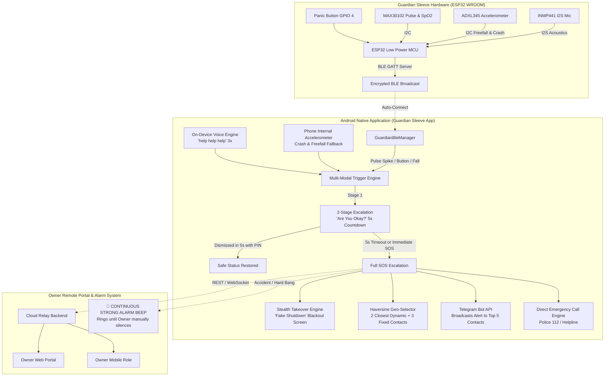

# Guardian Sleeve: Wearable IoT & Android Native Safety Architecture

## 1. System Overview

Guardian Sleeve provides multi-modal distress detection for women safety, child tracking, and accident deterrence. It bridges a low-power ESP32 wearable sleeve with a native Android smartphone app and a real-time Owner web/mobile monitoring portal.

---

## 2. Hard Bang, Collision Accident & Fall from Height Detection

### A. Detection Algorithm (Dual-Layer: ESP32 ADXL345 + Phone Sensor)
1. **Free-Fall Phase**: Weightlessness detection where acceleration vector $|a| = \sqrt{x^2+y^2+z^2} < 0.4\text{ g}$ ($<3.5\text{ m/s}^2$) for $> 120\text{ ms}$.
2. **Impact / Crash Bang Phase**: Sudden violent impact where vector magnitude $|a| > 4.8\text{ g}$ ($> 45\text{ m/s}^2$), or preceded by free-fall with $|a| > 3.5\text{ g}$.
3. **Trigger**: Emits `TriggerSource.ACCIDENT_FALL_BANG`.

### B. Two-Stage Escalation Workflow
- **Stage 1 (Carrier Prompt)**:
  - Phone vibrates and displays: *"Are you okay? Hard Bang / Crash / Fall from Height detected!"*
  - 5-second countdown timer.
  - If user taps **"I AM SAFE (CANCEL)"** within 5 seconds $\rightarrow$ safe status restored, no emergency dispatched.
- **Stage 2 (Owner Continuous Alarm)**:
  - If 5 seconds elapse without dismissal:
    1. **Continuous Strong Alarm Beep**:
       - **Owner Web Portal**: Web Audio API synthesizer loops alternating $900\text{ Hz}$ and $1350\text{ Hz}$ high-decibel alarm tones.
       - **Owner Mobile App**: Android `ToneGenerator` / `OwnerAlarmBuzzer` sounds repeating CDMA emergency alert ringbacks at maximum volume.
       - **Persistent Modal**: A full-screen flashing alert appears with: *"CRITICAL ACCIDENT ALARM! Hard Bang / Fall from Height detected for Sohan. 5s check was unanswered!"*
       - **Manual Acknowledgment Requirement**: The alarm keeps beeping in an infinite loop until the Owner physically presses **"🔕 MANUALLY SILENCE ALARM & ACKNOWLEDGE"**.
    2. **Telegram SOS Alert**: Dispatched to 2 geographically closest contacts + 3 fixed contacts with GPS coordinates.
    3. **Stealth Screen Takeover**: Phone displays realistic shutdown animation and turns pitch-black while continuing background tracking.
    4. **Direct Call**: Emergency call dispatched to 112 / police.
