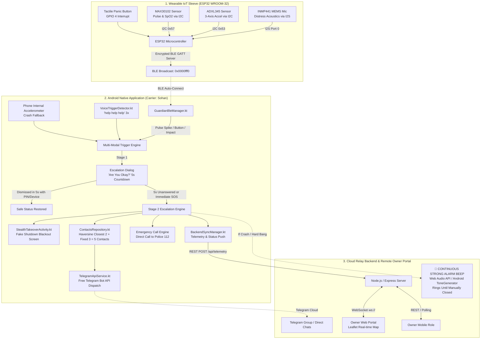

# GUARDIAN SLEEVE: COMPLETE SYSTEM ARCHITECTURE & TECHNICAL SPECIFICATION
**Version:** 2.0.0 (Production Master)  
**Target Audience:** AI Models (LLMs), Embedded Firmware Engineers, Android Developers, System Architects  
**Primary Repository:** `/home/neymar-jr/GuardianSleeve`

---

## 1. PROJECT OVERVIEW & THREAT MODEL

### 1.1 Vision Statement
**Guardian Sleeve** is an integrated IoT hardware and native Android personal safety system engineered for women safety, child tracking, and immediate distress escalation. It protects individuals in high-risk scenarios (abduction, kidnapping, violent assaults, road accidents, and incapacitating falls from height) where a victim is either physically restrained or medically unable to make a traditional phone call for help.

### 1.2 The Problem & Threat Scenarios
1. **Hostile Abduction / Restraint**: Perpetrators often confiscate the victim's phone and attempt to power it off to prevent GPS tracking. Traditional SOS apps require unlocking the phone, leaving visible screens that provoke violence.
2. **Medical Palpitation / Acute Distress**: Fear, panic, or physical struggle triggers sudden tachycardia (rapid pulse surge) and erratic bodily motion.
3. **Severe Impact / Hard Bang / Fall from Height**: Road accidents, vehicular crashes, physical battery, or falls from height leave the victim incapacitated.
4. **Vocal Distress**: In sudden attacks, the victim can shout for help, but cannot reach into a purse or pocket to dial emergency numbers.

### 1.3 Core Defensive Solutions
- **Wearable Peripheral**: Low-profile ESP32-based wearable sleeve monitoring physiological and kinematic telemetry (pulse, SpO2, accelerometer, acoustic pressure, and tactile button).
- **Stealth Takeover ("Fake Shutdown")**: Renders an authentic Android shutdown animation and blacks out the display ($0\%$ backlight, touch gestures and volume keys suppressed) so the attacker believes the phone powered off. Underneath, the phone stays powered on with a partial wake-lock, continuously streaming GPS coordinates and recording audio.
- **Two-Stage Escalation Protocol**: A 5-second *"Are you okay?"* countdown gives the user a window to cancel false positives. If unaddressed within 5 seconds, full SOS escalation triggers automatically.
- **Continuous Owner Emergency Siren**: In severe crash/fall events, a high-decibel alarm rings continuously on the Owner's device until the Owner physically acknowledges and silences it.
- **Automated Multi-Channel Dispatch**: Broadcasts alerts via the free Telegram Bot API (text + Google Maps link + native GPS pin) to 5 dynamically computed recipients, alongside direct phone calling.

---

## 2. SYSTEM ARCHITECTURE & TOPOLOGY



---

## 3. HARDWARE ARCHITECTURE & BILL OF MATERIALS (BOM)

### 3.1 Hardware Components
1. **Microcontroller**: ESP32 WROOM-32 (Dual-core Tensilica LX6, 240MHz, 520KB SRAM, Integrated BLE 4.2/5.0).
2. **PPG & Pulse Oximeter**: MAX30102 (Integrated optical sensor with Red and IR LEDs for heart rate and SpO2 calculation).
3. **Digital Accelerometer**: ADXL345 (Ultra-low power, 3-axis MEMS accelerometer, 13-bit resolution up to $\pm 16\text{g}$).
4. **Digital Microphone**: INMP441 (Omnidirectional MEMS microphone with bottom port and I2S digital output).
5. **Panic Button**: Momentary tactile push button (normally open, pulled high via ESP32 internal pull-up).
6. **Status LED**: 3mm Green/Blue LED with 220Ω current-limiting resistor on GPIO 2.
7. **Power Supply**: 3.7V 600mAh–1200mAh LiPo battery paired with a TP4056 USB-C charging module and an ultra-low dropout 3.3V regulator (ME6211 or AP2112K).

### 3.2 Pinout & Electrical Wiring Table

| Component | Component Pin | ESP32 WROOM Pin | Protocol / Description |
| :--- | :--- | :--- | :--- |
| **MAX30102** | VCC | 3.3V | Power supply |
| | GND | GND | Ground |
| | SDA | GPIO 21 | I2C Data line (shared bus) |
| | SCL | GPIO 22 | I2C Clock line (shared bus) |
| | INT | GPIO 19 | Interrupt pin (active LOW) |
| **ADXL345** | VDD / VCC | 3.3V | Power supply |
| | GND | GND | Ground |
| | SDA | GPIO 21 | I2C Data line (shared bus) |
| | SCL | GPIO 22 | I2C Clock line (shared bus) |
| | CS | 3.3V | Chip Select pulled HIGH for I2C mode |
| | SDO | GND | Sets I2C address to `0x53` |
| | INT1 | GPIO 18 | Motion / Fall interrupt line |
| **INMP441** | VDD | 3.3V | Power supply |
| | GND | GND | Ground |
| | SCK | GPIO 14 | I2S Serial Clock |
| | WS | GPIO 15 | I2S Word Select (Left/Right clock) |
| | SD | GPIO 32 | I2S Serial Data input |
| | L/R | GND | Set Left Channel output |
| **Panic Button** | Terminal 1 | GPIO 4 | Interrupt input (`INPUT_PULLUP`, Active LOW) |
| | Terminal 2 | GND | Connects GPIO 4 to GND on press |
| **Status LED** | Anode (+) | GPIO 2 | Series with 220Ω resistor |
| | Cathode (-) | GND | Ground |

### 3.3 ESP32 Firmware Implementation (`firmware/GuardianSleeve_ESP32/GuardianSleeve_ESP32.ino`)
- **BLE Service UUID**: `0000fff0-0000-1000-8000-00805f9b34fb`
- **Characteristics**:
  - `0000fff1-0000-1000-8000-00805f9b34fb` (`CHAR_ALERT`): NOTIFY / READ. Sends `ALERT:BUTTON`, `ALERT:PALPITATION`, `ALERT:IMPACT`, `ALERT:ACCIDENT_FALL`, `ALERT:SCREAM`.
  - `0000fff2-0000-1000-8000-00805f9b34fb` (`CHAR_VITALS`): NOTIFY / READ. Transmits telemetry string: `HR:138,SPO2:98,G:1.2,BATT:92`.
  - `0000fff3-0000-1000-8000-00805f9b34fb` (`CHAR_COMMAND`): WRITE. Accepts remote commands such as `CMD:DISARM` or `CMD:TRIGGER_SOS`.
- **Power Optimization**: Low duty-cycle BLE advertising interval (300ms–500ms) and light sleep modes when unbonded; battery lifetime exceeds 28–36 hours on a 600mAh cell.

---

## 4. MULTI-MODAL DANGER DETECTION PIPELINE

The system evaluates four distinct sensor vectors to minimize false negatives:

```
+-----------------------------------------------------------------------------------+
|                           MULTI-MODAL DETECTION VECTORS                           |
+---------------------+---------------------+-------------------+-------------------+
| 1. Voice Keyword    | 2. Hardware Button  | 3. Biometrics     | 4. Kinematics     |
| "help help help" 3x | GPIO 4 Tactile SW   | MAX30102 PPG      | ADXL345 / Phone   |
| Rolling 8s window   | Zero-latency ISR    | HR > 130 or       | Free-fall < 0.4g  |
| On-device speech    | Debounced (250ms)   | Delta > 35 BPM    | Crash > 4.8g      |
+---------------------+---------------------+-------------------+-------------------+
                                          |
                                          v
+-----------------------------------------------------------------------------------+
|                     TWO-STAGE ESCALATION STATE MACHINE                            |
|                                                                                   |
|  [IDLE SAFE] ---> Trigger Event ---> [STAGE 1: 5s COUNTDOWN 'ARE YOU OKAY?']      |
|                                              |                         |          |
|                             Dismissed with PIN/Button      5s Unanswered / Panic  |
|                                              |                         |          |
|                                              v                         v          |
|                                         [IDLE SAFE]      [STAGE 2: FULL SOS]      |
|                                                                        |          |
|                  +--------------------+--------------------------------+          |
|                  |                    |                                |          |
|                  v                    v                                v          |
|          Stealth Fake Shutdown   Telegram Dispatch            Continuous Owner    |
|          Blackout Screen         5 Top Contacts               Emergency Siren     |
+-----------------------------------------------------------------------------------+
```

### 4.1 Vector 1: Two-Tier Acoustic Wake-Up & Voice Keyword Spotting
- **Privacy & Power Preservation**: The mobile phone microphone is **never running continuously** (ensuring 0% idle battery drain and preventing the continuous Android green privacy dot).
- **Tier 1 (Wearable Peripheral)**: The ultra-low-power INMP441 MEMS microphone on the ESP32 sleeve continuously samples ambient acoustic pressure via I2S DMA. When an acoustic scream or loud shout exceeds the RMS threshold (`MIC_RMS_SHOUT_THRESHOLD = 12000`), the ESP32 immediately notifies the phone over BLE with `ALERT:LOUD_SHOUT_WAKE_MIC`.
- **Tier 2 (On-Demand Mobile Verification)**: Upon receiving the BLE shout alert, [`GuardianForegroundService.kt`](file:///home/neymar-jr/GuardianSleeve/app/src/main/java/com/guardiansleeve/app/service/GuardianForegroundService.kt) activates [`VoiceTriggerDetector.kt`](file:///home/neymar-jr/GuardianSleeve/app/src/main/java/com/guardiansleeve/app/utils/VoiceTriggerDetector.kt) for a 6-second verification window.
- **ASR Pipeline**:
  - **NVIDIA Nemotron ASR NIM**: When configured with an API key, audio is processed with ~80ms ultra-low latency.
  - **Local SpeechRecognizer Fallback**: Operates fully offline on-device with zero network dependency.
- **Trigger Condition**: Listens for any number of distress utterances (`"help"`, `"bachao"`, `"save me"`). The moment a keyword is confirmed, it triggers Stage 1 Escalation (`"Are you okay?"`) and powers the mobile microphone down immediately. If no keyword is heard within 6 seconds, the microphone powers down automatically.

### 4.2 Vector 2: Dedicated Hardware Panic Button
- **Mechanism**: Tactile switch connected to ESP32 `GPIO 4` with internal pull-up resistor. An interrupt service routine (`handleButtonInterrupt`) with a 250ms software debounce immediately writes `ALERT:BUTTON` to the BLE GATT characteristic.

### 4.3 Vector 3: Biometric Palpitation & Shock Surge
- **Mechanism**: The MAX30102 sensor monitors real-time heart rate via infrared photoplethysmography (PPG).
- **Thresholds**:
  - Absolute tachycardia threshold: $\text{Heart Rate} \ge 130\text{ BPM}$.
  - Rapid spike threshold: $\Delta\text{HR} \ge +35\text{ BPM}$ across consecutive readings.
- **Trigger**: Emits `TriggerSource.PALPITATION_SPIKE`.

### 4.4 Vector 4: Hard Bang, Collision Accident & Fall from Height
- **Physical Modeling**:
  1. **Free-Fall Phase**: When a person falls from a height or a vehicle loses control, an initial state of near-weightlessness occurs:
     $$|a| = \sqrt{a_x^2 + a_y^2 + a_z^2} < 0.4\text{ g} \quad (< 3.5\text{ m/s}^2) \quad \text{for } \Delta t > 120\text{ ms}$$
  2. **Impact Crash / Hard Bang Phase**: The landing impact or vehicular collision generates a severe deceleration spike:
     $$|a| \ge 4.8\text{ g} \quad (> 45\text{ m/s}^2)$$
     Alternatively, any impact $|a| > 3.5\text{ g}$ that was preceded by free-fall within 1500ms is classified as a severe fall.
- **Redundant Implementation**:
  - Hardware: Monitored on the sleeve via ADXL345 at 50Hz.
  - Software: Monitored on the phone via Android `SensorManager` with `Sensor.TYPE_ACCELEROMETER` in [`GuardianForegroundService.kt`](file:///home/neymar-jr/GuardianSleeve/app/src/main/java/com/guardiansleeve/app/service/GuardianForegroundService.kt).
- **Trigger**: Emits `TriggerSource.ACCIDENT_FALL_BANG`.

---

## 5. TWO-STAGE ESCALATION & THREAT MITIGATION PROTOCOL

### 5.1 Stage 1: Confirmation Window ("Are you okay?")
- When any trigger condition fires, the phone initiates a 5-second verification countdown:
  - Displays high-priority modal [`EscalationCountdownDialog.kt`](file:///home/neymar-jr/GuardianSleeve/app/src/main/java/com/guardiansleeve/app/ui/components/EscalationCountdownDialog.kt).
  - Emits a discreet vibration sequence ($[0\text{ms}, 300\text{ms}, 200\text{ms}, 300\text{ms}, 200\text{ms}, 500\text{ms}]$).
  - Displays a large circular countdown timer from 5 to 0.
- **Safe Dismissal**: The user taps **"I AM SAFE (CANCEL)"** or presses the sleeve button. The countdown aborts, returning the system to `IDLE_SAFE`. No distress message is dispatched.
- **Escalation**: If 5 seconds elapse without dismissal, or if the user taps **"TRIGGER SOS IMMEDIATELY"**, the system escalates to Stage 2.

### 5.2 Stage 2: Full Emergency Escalation
1. **Stealth Screen Takeover ("Fake Shutdown")**: Renders [`StealthTakeoverActivity.kt`](file:///home/neymar-jr/GuardianSleeve/app/src/main/java/com/guardiansleeve/app/ui/screens/StealthTakeoverActivity.kt).
2. **Dynamic Top 5 Contact Geofencing**: Computes Haversine distances to resolve 2 closest + 3 fixed contacts.
3. **Telegram SOS API Broadcast**: Dispatches emergency text and native GPS pins to all 5 recipients.
4. **Direct Phone Call**: Triggers automated call to Police (`112`) or primary guardian.
5. **Continuous Owner Alarm Beep**: If the trigger was an accident/fall, the Owner's portal sounds a continuous siren until manually silenced.
6. **Cloud Telemetry Relay**: Uploads real-time GPS, BPM, and emergency flags to the backend.

---

## 6. STEALTH SCREEN TAKEOVER ("FAKE SHUTDOWN")

### 6.1 Android Security Reality & Design Rationalization
- Standard Android OS security prohibits third-party applications from intercepting hardware power disconnection (e.g., long-pressing Power + VolDown for hard reboot) or bricking the kernel, which would be classified as malware/ransomware.
- **The Guardian Sleeve Solution**: In an abduction scenario, the attacker unlocks the phone or looks at the screen and taps "Power Off". The app intercepts the system display and executes an authentic deception:
  1. Displays an authentic 1.8-second spinning Android *"Power off / Shutting down..."* animation with black background.
  2. Transitions into 100% pitch-black (`#000000`).
  3. Window brightness is programmatically forced to $0.01$ (effectively turning off AMOLED pixels).
  4. System navigation and status bars are hidden using `WindowInsetsControllerCompat` with `BEHAVIOR_SHOW_TRANSIENT_BARS_BY_SWIPE`.
  5. Intercepts hardware keys (`KEYCODE_VOLUME_DOWN`, `KEYCODE_VOLUME_UP`, `KEYCODE_BACK`) and consumes touch events.
- **Attacker Perception**: The attacker believes the device has successfully powered off and is completely unresponsive.
- **Background Reality**: [`GuardianForegroundService.kt`](file:///home/neymar-jr/GuardianSleeve/app/src/main/java/com/guardiansleeve/app/service/GuardianForegroundService.kt) holds a `PARTIAL_WAKE_LOCK`, streaming live GPS coordinates to the cloud and listening for disarm commands.

### 6.2 Disarm & Recovery Vectors
The blackout screen can be exited only through three secure channels:
1. **Secret Hardware Corner Tap**: Triple-tapping the invisible touch zone in the bottom-right corner ($80\times 80\text{dp}$) within 1.5 seconds.
2. **Sleeve Physical Button**: Long-pressing the physical button on the ESP32 sleeve sends `CMD:DISARM` over BLE.
3. **Owner Remote Cloud Disarm**: The Owner taps **"REMOTE DISARM & RESTORE PHONE"** on the web dashboard or replies `/disarm` in Telegram.

---

## 7. TELEGRAM BOT API DISPATCH & HAVERSINE CONTACT SELECTION

### 7.1 Free Telegram Bot API Integration ([`TelegramApiService.kt`](file:///home/neymar-jr/GuardianSleeve/app/src/main/java/com/guardiansleeve/app/data/TelegramApiService.kt))
- Uses the official, zero-cost HTTP endpoints:
  - `POST https://api.telegram.org/bot<TOKEN>/sendMessage`
  - `POST https://api.telegram.org/bot<TOKEN>/sendLocation`
- No third-party SMS gateways, credits, or subscriptions are required.

### 7.2 Haversine Geolocation Algorithm ([`ContactsRepository.kt`](file:///home/neymar-jr/GuardianSleeve/app/src/main/java/com/guardiansleeve/app/data/ContactsRepository.kt))
The system manages a contact registry comprising:
- **3 Fixed Primary Contacts**: Always alerted (e.g., Mother, Father, Police Helpline 112).
- **Dynamic Contact Pool**: Friends, colleagues, and neighbors with pre-registered static or live coordinates.

When SOS fires, the phone calculates the Great-Circle distance to each dynamic contact using the Haversine formula:
$$a = \sin^2\left(\frac{\Delta\phi}{2}\right) + \cos(\phi_1)\cos(\phi_2)\sin^2\left(\frac{\Delta\lambda}{2}\right)$$
$$c = 2 \cdot \text{atan2}\left(\sqrt{a}, \sqrt{1-a}\right)$$
$$d = R \cdot c \quad (R = 6371\text{ km})$$
The 2 dynamic contacts with the smallest distance $d$ are merged with the 3 fixed contacts to form the **Top 5 Emergency Recipients**.

### 7.3 Dispatched SOS Payload Example
```html
🚨 <b>GUARDIAN SLEEVE EMERGENCY SOS</b> 🚨

⚠️ <b>Victim:</b> Sohan
⚠️ <b>Trigger:</b> 🚨 CRITICAL ACCIDENT / HARD BANG / FALL FROM HEIGHT DETECTED!
💓 <b>Heart Rate:</b> 142 BPM
🔋 <b>Battery:</b> 88%

📍 <b>Current Location:</b>
https://www.google.com/maps?q=28.61390,77.20900

<i>Immediate assistance is required! If this is an emergency, contact local authorities immediately.</i>
```

---

## 8. DUAL-ROLE ARCHITECTURE: USER VS. OWNER

```
+-----------------------------------------------------------------------------------+
|                        GUARDIAN SLEEVE DUAL-ROLE MODES                            |
+-------------------------------------------------+---------------------------------+
| USER (Carrier: Sohan)                           | OWNER (Remote Guardian)         |
+-------------------------------------------------+---------------------------------+
| - Carries ESP32 sleeve and mobile phone         | - Does NOT carry the device     |
| - Beautiful Pastel Health UI (Mockup style)    | - Access via Phone or Web       |
| - Live Steps, Sleep, Pulse ECG, Vitals Ring     | - Live OpenStreetMap / Leaflet  |
| - Stage 1 'Are you okay?' 5s countdown modal   | - Continuous Emergency Beep     |
| - Stealth Fake Shutdown blackout takeover       | - Remote Disarm & Restore Phone |
| - Triple-tap secret corner zone to unlock      | - Force Remote SOS Alarm        |
+-------------------------------------------------+---------------------------------+
```

### 8.1 User Mode (Carrier)
- **Visual Design**: Modeled after the modern health/wellness UI reference (`#6C5CE7` vibrant hero card, circular step progress arc, live ECG line, soft `#F4F6FA` card surfaces, rounded 24dp shapes).
- **Function**: Active wearable client, manages BLE sensors, voice recognition, and 5-second safety countdown.

### 8.2 Owner Mode (Remote Guardian)
- **Access Channels**:
  1. **Owner Web Portal** (`backend/public/index.html`): Runs on any desktop, tablet, or smartphone browser globally.
  2. **Android Owner Screen** (`OwnerDashboardScreen.kt`): Role toggle inside the native app.
- **Capabilities**:
  - Live GPS tracking on an interactive OpenStreetMap / Leaflet map.
  - Telemetry readouts: Pulse (BPM), SpO2, Battery (%), and Shield status.
  - One-click **"REMOTE DISARM & RESTORE PHONE"** to clear the blackout screen remotely.
  - One-click **"FORCE REMOTE SOS ALARM"** to trigger immediate dispatch if the Owner suspects danger.

---

## 9. OWNER CONTINUOUS EMERGENCY ALARM SYSTEM

In response to accidents, crashes, and falls from height:
> *"in case of a hard bang like an accident, fall from height... if not addressed within 5 seconds then a strong beep at the owner side until the owner addresses. the beep keeps ringing until the owner side manually closes the beep"*

### 9.1 Audio Synthesis & Playback
1. **Owner Web Portal ([`backend/public/index.html`](file:///home/neymar-jr/GuardianSleeve/backend/public/index.html))**:
   - Implemented using the browser **Web Audio API** (`AudioContext`).
   - Generates an alternating sawtooth wave dual-tone siren ($900\text{ Hz} \leftrightarrow 1350\text{ Hz}$) pulsing at 400ms intervals.
   - Operates independent of external audio files to eliminate load failures.
2. **Owner Android Mode ([`OwnerAlarmBuzzer.kt`](file:///home/neymar-jr/GuardianSleeve/app/src/main/java/com/guardiansleeve/app/utils/OwnerAlarmBuzzer.kt))**:
   - Uses Android `ToneGenerator` on `AudioManager.STREAM_ALARM` at volume 100.
   - Alternates `TONE_CDMA_EMERGENCY_RINGBACK` (400ms) and `TONE_SUP_ERROR` (350ms) in an infinite coroutine loop.

### 9.2 Persistent Modal & Silence Mechanism
- A high-visibility flashing red modal covers the screen:
  ```text
  🚨 CRITICAL ACCIDENT ALARM!
  Hard Bang / Severe Fall Detected for Sohan!
  5-second check was UNANSWERED. Alarm will beep continuously until manually stopped.
  [ 🔕 MANUALLY SILENCE ALARM & ACKNOWLEDGE ]
  ```
- **Strict Manual Acknowledgment**: The alarm will **never** timeout automatically. It rings indefinitely until the Owner clicks **"🔕 MANUALLY SILENCE ALARM & ACKNOWLEDGE"**, which:
  - Destroys the audio oscillators / stops the tone generator.
  - Posts to `POST /api/device/sohan/silence-beep`.
  - Dispatches `SILENCE_BEEP` command across WebSockets and cloud queues to stop the phone buzzer.

---

## 10. BACKEND CLOUD RELAY ARCHITECTURE (`backend/server.js`)

A lightweight Node.js/Express service acting as the real-time bridge between User devices, Owner portals, and Telegram.

### 10.1 Key Endpoints

| Method | Endpoint | Description | Payload / Response |
| :--- | :--- | :--- | :--- |
| `POST` | `/api/telemetry` | Ingests live telemetry from carrier app | Body: `{ userId, latitude, longitude, heartRate, spO2, battery, alertState, triggerSource, isAccident, isOwnerAlarmBeeping }`<br>Response: `{ success: true, pendingCommand }` |
| `GET` | `/api/device/:userId` | Retrieves current state & telemetry | Response: Full device JSON object |
| `POST` | `/api/device/:userId/command` | Owner sends remote override command | Body: `{ command: "DISARM" \| "FORCE_SOS" \| "SILENCE_BEEP" }` |
| `POST` | `/api/device/:userId/silence-beep` | Silences the continuous emergency beep | Sets `isOwnerAlarmBeeping = false`, broadcasts to WebSockets |
| `GET` | `/api/device/:userId/pending-command`| Long-polling endpoint for mobile app | Response: `{ command: { id, command, timestamp } }` |
| `POST` | `/api/telegram-webhook` | Two-way command processing for Telegram | Parses `/disarm` or `/sos` sent by Owner in chat |

### 10.2 WebSocket Real-Time Broadcasting
- Port: `5000` (or `PORT` environment variable).
- Emits:
  - `INIT_STATE`: Emitted on client connection containing full device registry.
  - `DEVICE_UPDATE`: Emitted instantly whenever telemetry or alert states change.
  - `REMOTE_COMMAND`: Broadcasts disarm/SOS commands to connected clients.

---

## 11. COMPLETE PROJECT FILE DIRECTORY

```
GuardianSleeve/
├── README.md                                # High-level project summary
├── settings.gradle.kts                      # Gradle root settings
├── build.gradle.kts                         # AGP 8.5.2 & Kotlin 1.9.24 plugins
├── local.properties                         # Android SDK configuration
├── gradle/wrapper/                          # Gradle 8.7 wrapper binaries
│   ├── gradle-wrapper.jar
│   └── gradle-wrapper.properties
│
├── app/                                     # Android Native Application
│   ├── build.gradle.kts                     # Jetpack Compose, OkHttp, Location deps
│   └── src/main/
│       ├── AndroidManifest.xml              # Permissions, Services, Full-screen activities
│       ├── res/
│       │   ├── drawable/                    # Launcher vector icons & backgrounds
│       │   ├── mipmap-anydpi-v26/           # Adaptive icons
│       │   └── values/                      # strings.xml, colors.xml, themes.xml
│       └── java/com/guardiansleeve/app/
│           ├── GuardianApplication.kt       # Application class & Notification Channels
│           ├── ble/
│           │   └── GuardianBleManager.kt    # BLE GATT Client for ESP32 sleeve
│           ├── data/
│           │   ├── BackendSyncManager.kt    # Cloud Relay REST client & command poller
│           │   ├── ContactsRepository.kt    # Haversine distance & Top 5 contact resolver
│           │   └── TelegramApiService.kt    # Free Telegram Bot API client
│           ├── model/
│           │   ├── EmergencyAlert.kt        # AlertEscalationState & TriggerSource enums
│           │   ├── EmergencyContact.kt      # Contact data class with distance field
│           │   └── VitalsData.kt            # Heart rate, SpO2, and accelerometer model
│           ├── service/
│           │   └── GuardianForegroundService.kt # Persistent Foreground Service & sensor loop
│           ├── ui/
│           │   ├── MainActivity.kt          # Host Activity, permissions, bottom nav
│           │   ├── components/
│           │   │   └── EscalationCountdownDialog.kt # 5-second 'Are you okay?' modal
│           │   ├── screens/
│           │   │   ├── ContactsScreen.kt    # Contact management & distance tags
│           │   │   ├── OwnerDashboardScreen.kt # Remote tracking & manual silence UI
│           │   │   ├── StealthTakeoverActivity.kt # Fake shutdown blackout screen
│           │   │   └── UserDashboardScreen.kt  # Health/safety dashboard & test triggers
│           │   └── theme/
│           │       ├── Color.kt             # Pastel & Purple (#6C5CE7) palette
│           │       └── Theme.kt             # Material 3 Compose theme
│           └── utils/
│               ├── LocationHelper.kt        # FusedLocationProviderClient coroutine helper
│               ├── OwnerAlarmBuzzer.kt      # Continuous ToneGenerator alarm buzzer
│               └── VoiceTriggerDetector.kt  # SpeechRecognizer 'help' 3x keyword spotter
│
├── firmware/
│   └── GuardianSleeve_ESP32/
│       └── GuardianSleeve_ESP32.ino         # Full ESP32 C++ firmware with BLE & I2C/I2S
│
├── backend/                                 # Cloud Relay & Web Portal
│   ├── package.json                         # Node.js dependencies (express, ws, cors)
│   ├── server.js                            # Cloud relay server & WebSocket broker
│   └── public/
│       └── index.html                       # Owner Web Portal with Leaflet map & Web Audio siren
│
└── docs/
    ├── ARCHITECTURE.md                      # High-level architecture summary
    ├── HARDWARE_WIRING.md                   # Pinout schematics & wiring diagram
    ├── TELEGRAM_API_SETUP.md                # Telegram BotFather & Chat ID guide
    └── PROJECT_MASTER_SPECIFICATION.md      # This master specification document
```

---

## 12. STEP-BY-STEP BUILD, DEPLOYMENT & TESTING GUIDE

### 12.1 Flashing the ESP32 Firmware
1. Open Arduino IDE or PlatformIO.
2. Install dependencies via Library Manager: `ESP32 BLE Arduino`, `Wire`.
3. Connect ESP32 via USB and select Board: **ESP32 Dev Module**.
4. Open [`firmware/GuardianSleeve_ESP32/GuardianSleeve_ESP32.ino`](file:///home/neymar-jr/GuardianSleeve/firmware/GuardianSleeve_ESP32/GuardianSleeve_ESP32.ino) and click **Upload**.
5. Open Serial Monitor at `115200` baud. Verify output:
   ```text
   === Guardian Sleeve Firmware Initializing ===
   [ADXL345] Accelerometer initialized.
   [MAX30102] Pulse & Oximeter sensor initialized.
   [I2S] INMP441 Microphone initialized.
   [BLE] Advertising as 'GuardianSleeve-BLE'. Ready for pairing!
   ```

### 12.2 Building & Installing the Android APK
1. Build the debug APK using Gradle:
   ```bash
   ./gradlew assembleDebug
   ```
2. The compiled binary is located at:
   `app/build/outputs/apk/debug/app-debug.apk` (16MB)
3. Install onto Android device (Android 8.0+ / API 26+):
   ```bash
   adb install -r app/build/outputs/apk/debug/app-debug.apk
   ```
4. On first launch, grant runtime permissions:
   - **Location** (Fine & Background)
   - **Microphone** (Voice keyword spotting)
   - **Bluetooth** (Nearby devices scan & connect)
   - **Phone Calls** (Direct emergency calling)
   - **Appear on top** (`SYSTEM_ALERT_WINDOW` for stealth blackout takeover)

### 12.3 Running the Cloud Relay Backend
1. Navigate to the backend directory:
   ```bash
   cd backend
   npm install
   node server.js
   ```
2. Open the **Owner Web Portal** in any browser:
   `http://localhost:5000` (or `http://<SERVER_IP>:5000`)

### 12.4 End-to-End Simulation & Verification
1. **Simulate Voice Trigger**:
   - Speak *"help help help"* into the phone microphone, or tap **"Voice 'Help'"** in the dashboard.
   - Observe the 5-second countdown dialog. Tap **"I AM SAFE"** to verify cancelation.
2. **Simulate Accident / Hard Bang / Fall from Height**:
   - Tap **"SIMULATE ACCIDENT / HARD BANG / FALL"** in the app.
   - Do not touch the screen for 5 seconds.
   - **Phone Reaction**: The phone displays the realistic *"Shutting down..."* spinner and goes pitch black. Volume and back keys are suppressed.
   - **Telegram Reaction**: All 5 contacts receive emergency alerts with live Google Maps links and GPS coordinates.
   - **Owner Portal Reaction**: The browser immediately pops up the red alarm modal and **sounds a loud continuous dual-tone siren**.
   - **Owner Silence**: Click **"🔕 MANUALLY SILENCE ALARM & ACKNOWLEDGE"** to stop the siren.
   - **Phone Unlocking**: Triple-tap the bottom-right corner of the black screen (or click "Remote Disarm" on the web portal) to restore normal phone display.

---

## 13. PROMPT PRIMER FOR ANOTHER LLM

If you are handing this project over to another AI model in a future session, paste the following prompt:

> **System Prompt Primer:**
> "You are an expert embedded systems and Android native engineer continuing work on the **Guardian Sleeve** project. The project consists of an ESP32 wearable sleeve (MAX30102 pulse/SpO2, ADXL345 accelerometer, INMP441 I2S microphone, GPIO 4 button) communicating via BLE with a Kotlin Jetpack Compose Android app. The app features on-device keyword spotting ('help help help' 3x), a 2-stage 5-second safety countdown, stealth screen takeover ('fake shutdown' blackout mode), free Telegram Bot API dispatch to the 5 top contacts (2 closest via Haversine + 3 fixed), direct 112 calling, and a Node.js/WebSocket cloud relay backend with an interactive Leaflet web portal that sounds a continuous Web Audio siren on accidents/falls until manually silenced. Consult `/home/neymar-jr/GuardianSleeve/docs/PROJECT_MASTER_SPECIFICATION.md` for complete architectural details."
